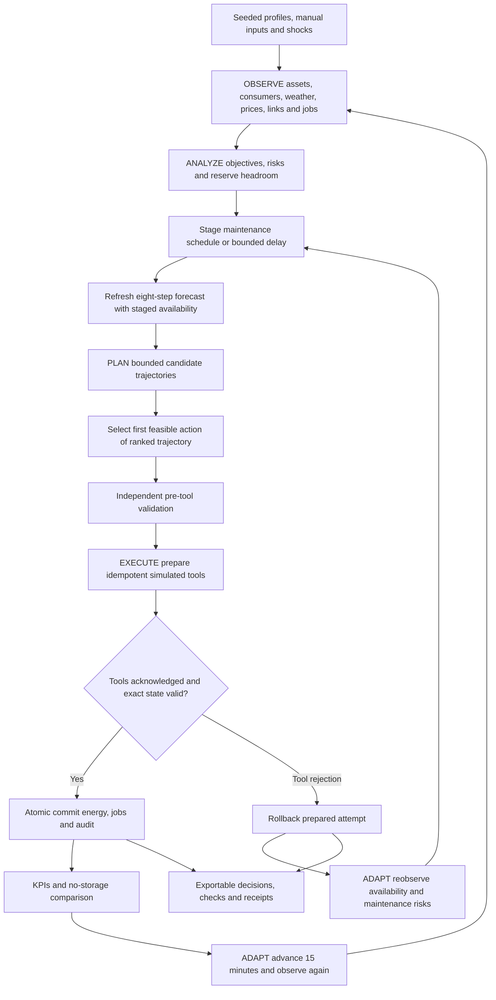

# GridPilot - Detailed Structural Architecture

## Operating model

GridPilot coordinates a synthetic portfolio every 15 minutes. It reduces modeled cost/emissions, uses renewable generation and protects demand while respecting asset, transport, consumer and maintenance constraints. Every observation, trade, setpoint, job and inspection dispatch is simulated.

The portfolio comprises five solar farms (20 MW total), three wind farms (12 MW), two batteries, three consumers and two grid interconnections. Each farm exposes local output variation and maintenance availability; dispatch search aggregates generation by source. Consumers retain separate deferred-energy ledgers. Grid links are parallel transport capacities, rather than an AC network.

## Process flow

Invalid proposals are rejected before commit. The injected Battery B rejection demonstrates rollback and a replacement plan at the same tick.

## State and inputs

| Resource/input | Implemented model |
|---|---|
| Renewables | Solar capacities 6, 5, 4, 3, 2 MW; wind 5, 4, 3 MW. Time profiles, seeded local variation, weather/shocks and job availability determine output. |
| Batteries | A: 12 MWh / 8 MW; B: 8 MWh / 5 MW. Initial SOC 60% each. Independent SOC, efficiency, availability, throughput and illustrative health. |
| Consumers | Steel: 45% demand share / 88% critical; cold storage: 35% / 75%; assembly: 20% / 70%. Synthetic demand shares. |
| Grid | Main link normally 10 MW import / 5 MW export; secondary 8 MW / 3 MW. Congestion/storms restrict import capacity. Exchange routes in proportion to link limits. |
| Market | Synthetic tariffs; export price is 38% of import price. Explicit carbon price and demand-response incentive. No bids or settlement. |
| Weather | Cloud cover, wind speed, storm alert and update tick. Overrides can fix cloud/wind until restored. Forecasts remain synthetic. |
| Frequency | Synthetic observed signal, 50 Hz target and a battery-response proxy. No voltage, inertia, protection or electrical dynamics. |
| Maintenance | Asset, start tick, duration, original start and permitted delay for solar, wind and battery jobs. Additional jobs can be injected. |

Manual ranges: carbon INR 0-20,000/tonne, incentive INR 0-10,000/MWh, frequency 49.5-50.5 Hz, clouds 0-100% and wind 0-30 m/s. Invalid/unknown fields are rejected. The editor shows upcoming inputs; completed records preserve the actual observation used for their decision.

## Stages and decision model

| Stage | Responsibility and evidence |
|---|---|
| Observe | Snapshot assets, consumers, batteries, weather, market, lines, frequency and jobs; retain forecast. |
| Analyze | Determine effective priorities, shortfall/availability risks and uncertainty reserves; expose weights and rationale. |
| Plan | Determine maintenance actions, reflect staged delays in forecast availability, search dispatch trajectories and expose alternatives. |
| Execute | Stage source dispatch, batteries, consumer schedules, routing, trades and jobs with idempotency keys; retain receipts. |
| Validate | Independently check the proposal before tools and exact prepared result before commit; retain reasons. |
| Adapt | On rejection, roll back and refresh availability/maintenance decisions before replanning. Otherwise advance time and observe again. |

Decision intelligence is **bounded beam search**, without a live LLM or trained predictor. Across eight 15-minute steps it considers fleet charge/discharge/hold targets, flexible-demand options, solar-first/wind-first curtailment and a frequency-support target. It simulates transitions and retains up to 12 distinct states. Horizon ranking values remaining usable battery energy and future pending-load obligations. Only the first action executes. Search returns the best explored candidate, without global optimality proof.

Maintenance uses a separate transparent policy rather than exhaustive schedule optimization. A flexible job due next interval can be delayed during supply, storm, frequency or availability risk. A delay moves start by up to four ticks and never exceeds original start plus eight ticks; at the deadline the job is honored. Staged delays affect future availability **before** dispatch search, but job state changes only on commit. After a tool failure, maintenance risks/actions and the forecast are recomputed for the replacement transaction. Storms may stage a simulated inspection receipt.

## Objectives, costs and uncertainty

Select Balanced, Lowest cost, Clean energy or Reliability. A storm or observed frequency-proxy deviation of at least 0.20 Hz temporarily forces Reliability. Scoring combines operating cost, imported carbon, unmet energy, curtailment, reserve deficit and frequency-proxy deviation beyond a 0.08 Hz deadband.

| Profile | Cost | Carbon | Reserve | Curtailment | Unserved | Frequency | Base SOC floor |
|---|---:|---:|---:|---:|---:|---:|---:|
| Balanced | 1 | 4 | 2,400 | 2,500 | 1,000,000 | 120,000 | 15% |
| Lowest cost | 1 | 0 | 0 | 0 | 1,000,000 | 60,000 | 10% |
| Clean | 0.3 | 24 | 1,200 | 8,000 | 1,000,000 | 120,000 | 15% |
| Reliability | 0.3 | 2 | 16,000 | 1,500 | 4,000,000 | 400,000 | 30%; 35% storm |

These are synthetic score weights, not tariffs or fitted valuations. Operating cost is purchases less exports, plus carbon charges, degradation, source-curtailment charges and shift compensation, minus demand-response incentive revenue. Carbon price taxes imported emissions; the separate carbon weight expresses a nonfinancial preference. Both renewable types have zero modeled operational emissions, so source selection is not a lifecycle cleanliness comparison.

Ordinary uncertainty above 8% increases reserves: `floor = min(0.40, baseFloor + max(0, uncertaintyPct - 0.08) * 0.20)`; reserve weight is multiplied by `1 + max(0, uncertaintyPct - 0.08)`. Storms keep the 35% floor, reduce future solar/wind by 10% and raise forecast demand by 5%. The soft reserve target is at least 45% on available batteries. A battery below a raised floor cannot discharge further until recharged; no energy is invented.

Tick score sums weighted operating cost, carbon kg, unserved MWh, curtailment MWh, reserve-gap MWh times 0.25, and `max(0, abs(frequencyAfterHz - 50) - 0.08) * frequencyWeight * 0.25`. Full-horizon ranking also accounts for terminal inventory/backlog. The audit distinguishes these scopes. Forecast confidence/uncertainty is synthetic metadata, not calibrated probability or measured accuracy.

## Accounting and constraints

Power is MW; energy is MWh; a tick is 0.25 hour. Prices/incentives/charges are INR/MWh; carbon price is INR/tonne CO2. Imported energy uses 420 kg CO2/MWh.

Battery SOC follows `next = now + chargeMW * 0.25 * 0.92 - dischargeMW * 0.25 / 0.92`. Both efficiency legs are 92%, hence 84.64% round trip. Throughput cost is INR 150/MWh. Illustrative health loses `throughputMWh / capacityMWh * 0.002` percentage points each tick, floored at 80%. This ledger does not reduce nameplate capacity/power or represent calibrated chemistry/aging.

Fleet charging/discharging and grid importing/exporting cannot occur simultaneously. Source curtailment sums to total curtailment and cannot exceed each source's observed output. Synthetic curtailment charges are INR 200/MWh solar, INR 350/MWh wind, or INR 50/MWh wind during storms.

Deferral is capped by 2 MW, 10% total demand and available flexible load. Named consumer energy is due within four ticks (one hour), and total backlog is capped at 1.5 MWh. Early restoration is capped at 2.5 MW; due energy returns. Compensation is INR 250/deferred MWh less the explicit incentive. Restoration goes back to the same consumer. If supply is insufficient, flexible demand is shed before critical demand; within each class assembly precedes cold storage then steel. All shortfalls are reported.

Frequency response is `clamp(observedHz + 0.02 * (dischargeMW - chargeMW), 49.5, 50.5)`. Validation verifies this formula, **not electrical stability**. Energy/availability constraints can leave the proxy outside its target.

## Tools, validation and recovery

Tools: `renewable.dispatch`, individual `battery.dispatch`, `industrial.schedule`, `grid.route`, `market.trade`, `maintenance.schedule`, `maintenance.delay`, `inspection.dispatch` and transaction rollback/commit. They mutate local simulated state only.

Independent checks cover finite values, power balance, observed generation, source curtailment, per-line caps, per-consumer energy/deadlines, critical-load protection, no conflicting commands, battery SOC/efficiency/availability/reserves, throughput/health, frequency-proxy accounting and job windows. These checks do not certify operational safety.

Injected Battery B rejection rolls back every prepared command. No energy, money or schedule has committed. B is marked unavailable for eight ticks; availability, maintenance risks/actions and the forecast are refreshed. The replacement is planned and validated, and one authoritative transition commits. Duplicate transaction IDs cannot commit twice. Receipts distinguish rejected, rolled-back and committed attempts.

## Baseline and evidence

The no-storage baseline uses the same generation, links and exact demand schedule after agent deferral/restoration. Both costs include identical shift compensation/incentive revenue. This isolates storage, rather than independently evaluating a flexibility policy. Compare critical shortfalls, delivered service and pending work beside cost.

Costs include 12 MWh initial stored energy and potentially different final SOC; terminal inventory is not cash-valued and capital is excluded. This cannot establish annual savings, full profit or payback. Renewable utilization includes exports/charging. Demand-served percentage covers scheduled energy; pending backlog is separate. Emissions cover imports rather than lifecycle emissions.

**27 tests passed**, covering 2,592 seeded day intervals and 384 mixed shocks plus focused features/recovery. A separate evaluator validated **993/993 cycles**. Passing constraints does not imply full service: the recorded congestion day serves about 67.3% and storm about 59.7%. See [VALIDATION.md](VALIDATION.md) and [VALIDATION_RESULTS.json](VALIDATION_RESULTS.json) for exact results. Tests verify model consistency, not real-world forecasts/reliability.

The UI performs one initial tick; **Run 24 hours** appends 96. Evaluator day runs separately start fresh with 96 cycles. Regenerate evidence after model changes.

## Scope and grid assessment

Local seeded simulation has no API key, live LLM, trained forecasting service, market connection or hardware. Farm dispatch is aggregated by source; link flows use proportional transport routing. No AC/DC power flow, voltage, inertia, network protection, real settlement, calibrated aging or measured forecast accuracy is implemented. Inspection is a receipt; maintenance is a bounded policy rather than crew-routing/safety optimization.

The conservative proposed assessment is **F3 / D1**: simulate changing conditions over time, select coordinated actions under explicit criteria/uncertainty, and demonstrate constrained results from structured inputs. D2 needs defensible high-reliability evidence beyond test counts; D3 is not claimed. [REQUIREMENTS_COVERAGE.md](REQUIREMENTS_COVERAGE.md) maps features and simplifications to the brief.
